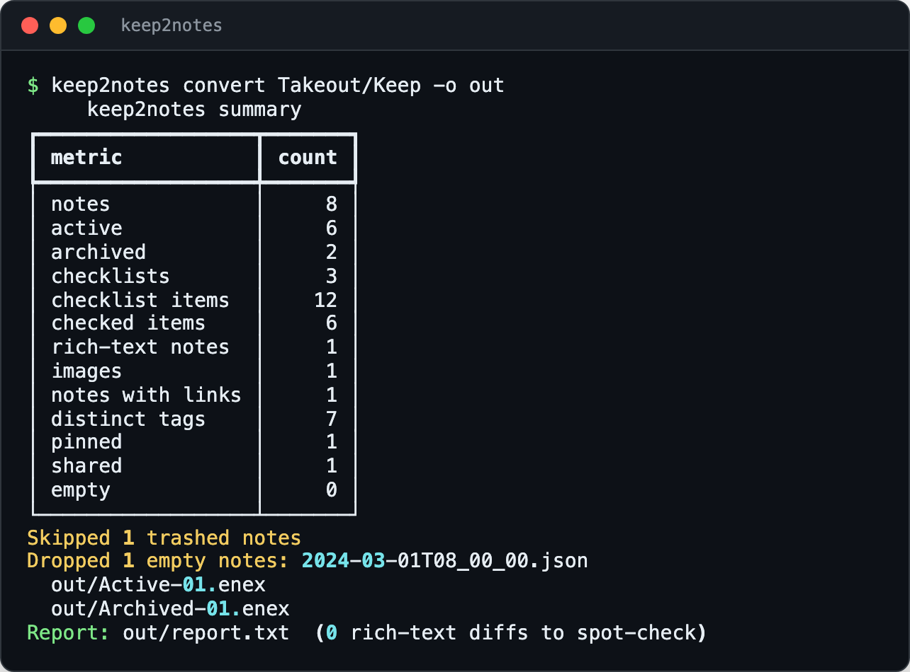
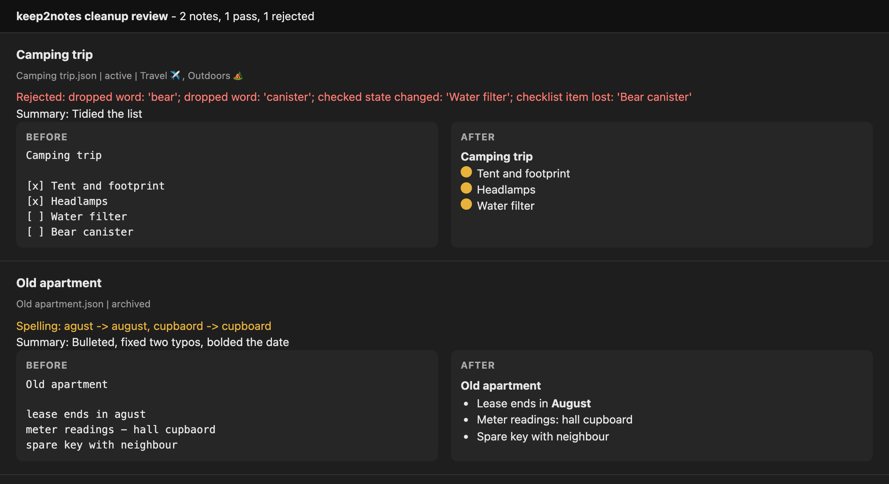

<div align="center">

<h1>keep2notes</h1>

<p><b>Google Keep, moved into Apple Notes.</b></p>

<p><i>Apple Notes has no Keep importer, and copy-paste flattens checklists, drops labels and stamps every note with today's date.</i></p>

<h6>


</h6>

<a href="#how-it-works"><b>How it works</b></a> ·
<a href="#features"><b>Features</b></a> ·
<a href="#install-and-run"><b>Install and run</b></a> ·
<a href="#what-does-not-carry-over"><b>Limits</b></a>

<br><br>



<sub>A real run on a small made-up Keep export.</sub>

</div>

<br>

## Why

Google Takeout exports Keep as one JSON file per note. Apple Notes can't read that, but it
can import Evernote's `.enex` format, and its importer understands native checklists, tags,
original dates and embedded images. keep2notes writes exactly the subset of ENEX that Apple
Notes accepts, then checks the import afterwards so you know nothing was lost.

## How it works

<table>
<tr>
<td width="33%" valign="top">

**1 · Export**

Download Keep from [Google Takeout](https://takeout.google.com) and unzip it. You need the
`Takeout/Keep` folder.

</td>
<td width="33%" valign="top">

**2 · Convert**

`keep2notes convert` writes `.enex` files in batches of 75, active and archived notes
separately, plus a `report.txt` of things to check by hand.

</td>
<td width="33%" valign="top">

**3 · Import and verify**

In Notes, **File > Import to Notes**. Then `keep2notes verify` compares the folder in Notes
against the `.enex` files, read-only.

</td>
</tr>
</table>

## Features

- **Native checklists.** Keep lists become Apple Notes checklists, with each item's checked state kept.
- **Labels become tags.** Every Keep label is a tag, several per note. Notes tags can't contain
  spaces, so `Movies & Shows 🎥🍿` becomes `#MoviesShows🎥🍿`, or `#MoviesShows` with `--strip-emoji-tags`.
- **Original dates.** Created and modified times come from Keep's timestamps, not the import day.
- **Images and links.** Attachments are embedded; link previews that aren't already in the text
  are added under a **Links** heading.
- **Rich text.** Bold, italic, underline, strikethrough and links carry over; headings become bold.
- **Sensible titles.** Untitled notes take their first line as the title.
- **A rehearsal first.** `smoke` writes 8 synthetic notes, one per feature, and `--pilot N` picks N
  of your own notes that between them cover checklists, images, tags, links, archived and pinned.
- **Verification.** `verify` matches note titles through AppleScript; `verify --deep` reads a copy of
  Notes' database and checks dates, tags, images and checklist state for every note.
- **Optional cleanup with a safety net.** Tidy notes before import; any edit that drops a word or a
  checklist item is rejected.

## Clean up before you import

<div align="center">



<sub>The review page from <code>cleanup-validate --review</code>, on made-up notes.</sub>

</div>

Years of Keep notes are often a mess of dashes, typos and half-formatted lists. `cleanup-prep`
splits your notes into JSON chunks for an editor, a person or an AI agent, to rewrite as
headings, bullets, numbered lists and checklists. Each cleaned note is an overlay that replaces
only the title and body; labels, dates, images and archive state always come from Keep.

`cleanup-validate` checks every overlay against the original: every word must survive (close spelling
fixes and typed `#hashtag` lines are allowed), every checklist item must be present, and no
checked state may change. `convert --overlays` applies only the overlays that pass.

## Install and run

Needs [uv](https://docs.astral.sh/uv/) and Python 3.11 or newer. Converting works anywhere;
`verify` needs a Mac with Notes.

```bash
git clone https://github.com/parthchandak02/keep2notes.git
cd keep2notes
uv run keep2notes smoke -o out                                   # 8 synthetic test notes
uv run keep2notes convert ~/Downloads/Takeout/Keep -o out --pilot 10   # 10 real notes covering each feature
uv run keep2notes convert ~/Downloads/Takeout/Keep -o out              # everything, in batches of 75
uv run keep2notes verify out/Active-01.enex --folder "Imported Notes"  # after importing
```

Importing can't be undone, and importing a file twice makes duplicates. A safe order:

1. Turn on **Notes > Settings > "On My Mac" account** and import `Smoke.enex` and `Pilot.enex`
   there first, so nothing syncs.
2. Import everything into On My Mac once and run `verify`.
3. Import about 10 notes into iCloud and check them on your phone.
4. Import the real batches into iCloud one at a time, running `verify` after each.

`verify --deep` reads a temporary copy of `NoteStore.sqlite`, so the app running it (Terminal,
an editor) needs Full Disk Access.

## What does not carry over

Apple Notes' importer has no field for these:

| Keep | In Apple Notes |
|---|---|
| Pinned | Tagged `#Pinned` so you can find and pin them by hand |
| Shared with others | Listed in `report.txt`; sharing must be set up again |
| Note colours | Dropped |
| Headings | Bold text |
| Trashed notes | Skipped unless `--include-trashed` |
| Empty notes | Dropped unless `--keep-empty` |

Smart Folders can't be created by script; use **File > New Smart Folder** with a tag filter.

<details>
<summary><b>All commands and options</b></summary>

| Command | |
|---|---|
| `convert <Keep dir> -o out` | Write `Active-NN.enex`, `Archived-NN.enex` and `report.txt` |
| `  --batch-size N` | Notes per file (default 75) |
| `  --pilot N` | Write only `Pilot.enex` with N feature-covering notes |
| `  --strip-emoji-tags` | Drop emoji from tag names |
| `  --include-trashed` | Also convert notes in Keep's trash |
| `  --keep-empty` | Keep notes with no title, text, items or images |
| `  --overlays DIR` | Apply validated cleaned-note overlays |
| `smoke -o out` | Write `Smoke.enex` with 8 synthetic one-feature notes |
| `verify <enex...> --folder F [--account iCloud] [--deep]` | Compare a Notes folder against the files, read-only |
| `show <Keep dir> "<title>"` | Print the converted body of matching notes |
| `cleanup-prep <Keep dir> -o out/cleanup [--chunks 8] [--pilot N] [--skip-done DIR]` | Write note chunks for editing |
| `cleanup-validate <Keep dir> <overlay dir> [--review page.html]` | Check overlays; optionally write a before/after page |

`report.txt` lists the label-to-tag mapping, pinned notes, shared notes, notes whose rich text
differs from Keep's plain text, and missing attachments.

</details>

<details>
<summary><b>Overlay format</b></summary>

One JSON file per note in the overlay folder:

```json
{"source": "Trip.json", "title": "Trip", "blocks": [
  {"type": "heading", "text": "Documents"},
  {"type": "check", "text": "Passport", "checked": false},
  {"type": "bullet", "text": "Snacks"},
  {"type": "number", "text": "Step one"},
  {"type": "text", "text": "Plain paragraph with **bold**"},
  {"type": "blank"}
], "changes": "one-line summary"}
```

</details>

<details>
<summary><b>Project layout and development</b></summary>

```
src/keep2notes/
  cli.py         Commands and the summary table
  model.py       Reads Takeout's per-note JSON
  enex.py        Writes ENEX notes, tags, dates and embedded images
  html_clean.py  Keep's styled HTML to ENML
  tags.py        Label to tag-name mapping
  cleanup.py     Overlay chunks, rendering and validation
  review.py      Before/after HTML review page
  verify.py      AppleScript title check
  notestore.py   Read-only NoteStore.sqlite reader for --deep
  smoke.py       Synthetic test notes
tests/           pytest, synthetic notes only
```

```bash
uv run pytest
```

Real exports, `out/`, `.enex` files and `report.txt` are gitignored.

</details>

<br>

<div align="center">
<sub>Built with Python and Rich. Writes Evernote's ENEX format, as read by Apple Notes' importer.</sub>
</div>
